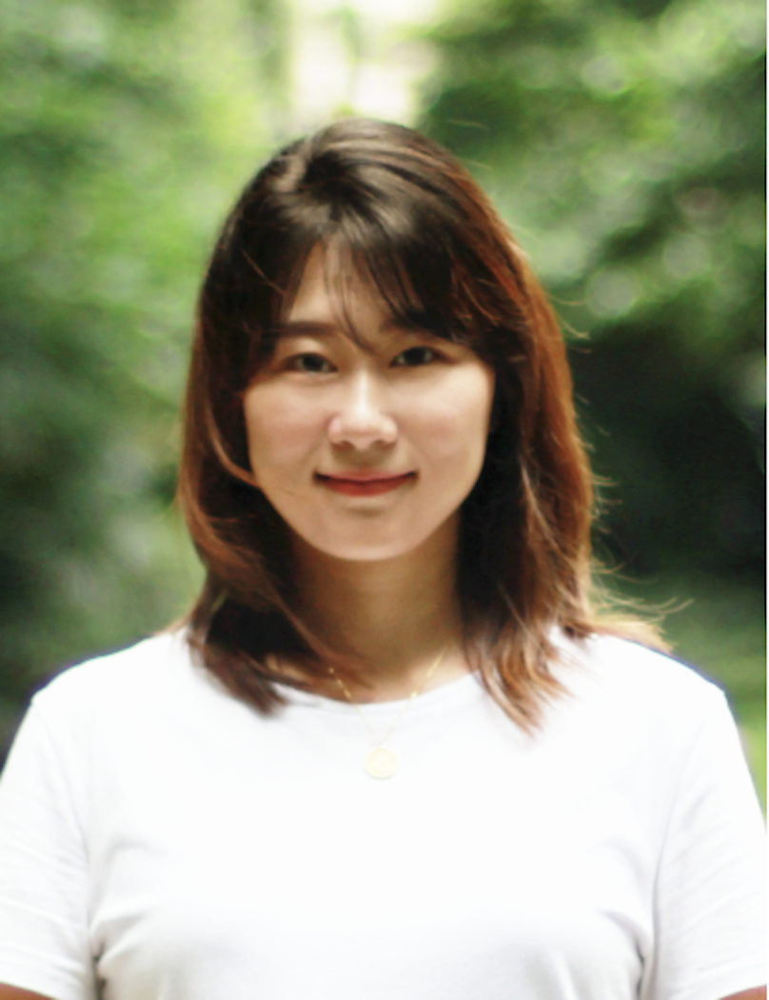

# Yan Jiang

Postdoctoral Scholar  
Stanford Center on Early Childhood

[About](./) / [Research](./research) / [Teaching](./teaching) / [CV](./cv)

---

  

Welcome! I am a Postdoctoral Scholar at the Stanford Center on Early Childhood. My interdisciplinary research bridges developmental science, early childhood education, and data science to examine how social, cultural, and institutional conditions shape children’s development across family and education settings. My work addresses: (1) how unequal resources and structural conditions shape what families and educators can provide for children; (2) whose knowledge and practices are privileged in dominant conceptions of development; and (3) how methodological pluralism can reveal insights beyond what any single method can offer. I received my Ph.D. in Education Studies, with a specialization in Computational Social Science, from the University of California, San Diego.  

## Contact & Profiles

Email: [yannj@stanford.edu](mailto:yannj@stanford.edu)  

[Google Scholar](https://scholar.google.com/citations?user=MlJpstYAAAAJ&hl=en) | [Stanford Profile](https://profiles.stanford.edu/375572) | [LinkedIn](https://www.linkedin.com/in/yan-jiang-%E5%A7%9C%E7%90%B0-8b68a5235/)

## Updates
2026/10: My paper, “Whose Knowledge Counts? Mapping Global Inequalities in Early Childhood Education Research Production,” was accepted for presentation at the 71st Annual Meeting of the Comparative and International Education Society (CIES 2027).

2026/09: Our session, “From Data to Lived Experience: Understanding Child Care Workforce Strain Across Settings,” was accepted for presentation at the 2026 NAEYC Annual Conference in Washington, DC (December 5–8).

2026/09: My paper, “Navigating the ‘Ideals’: A Comparative Case Study of Early Educators’ Sensemaking of Quality in the United States and China,” is now available online in [*Teaching and Teacher Education*](https://www.sciencedirect.com/science/article/pii/S0742051X26004208).

2026/05: My dissertation received an honorable mention for the UC Chancellor’s Dissertation Medal.
